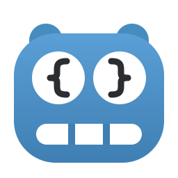
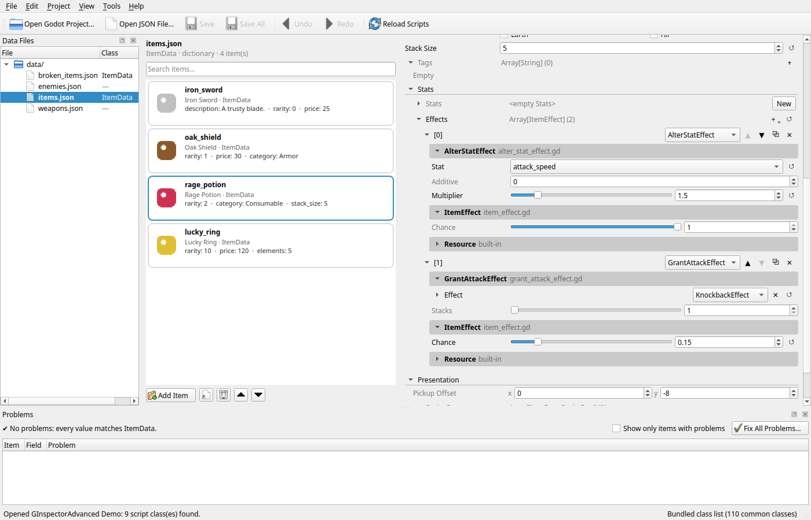
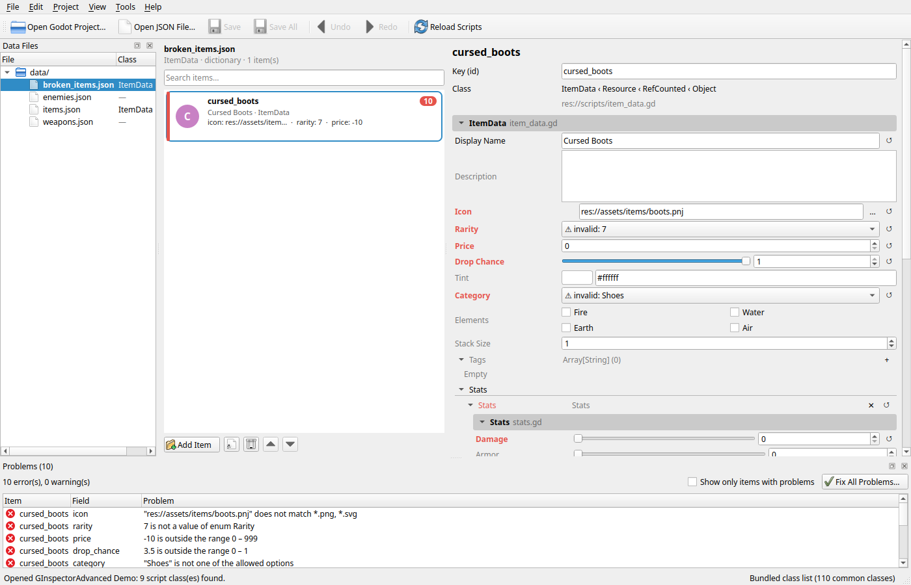

<p align="center">
  
</p>

# GInspectorAdvanced

A visual editor for the JSON data files of a **Godot 4** project. You link each JSON file to the class that
describes its objects (a GDScript class, a C# class or a built-in Godot class). Each item in the file then
shows up as a **card**, and its values open in an **inspector page** that works like Godot's own inspector.

The inspector only lets you add the variables that the class declares, and it applies the restrictions of
each variable (`@export_range`, enums, flags, file filters, types…). That way the JSON always matches the
class that will load it.

Runs on **Windows and Linux** (Qt 6 / C++17).



---

## Features

- **Open a Godot project** (any folder with a `project.godot`). Every `.gd` and `.cs` script is scanned for classes.
- **Pick a JSON file, then its class.** The class can be a project script with `class_name`, a script without
  `class_name` (referenced by path), an inner class (`Outer.Inner`), a C# class, a built-in Godot class, or
  any script file you browse to.
- **`ginspector.json`** is written at the project root. It records which JSON is linked to which class, so you
  only choose once.
- **Cards** for each item: thumbnail (from any `res://` image path in the item), title, a summary of its
  values, a red badge with the number of problems, and a dot for unsaved changes. You can search and filter.
- **Inspector** built from the class:
  - one section per class in the inheritance chain (your scripts first, built-in classes collapsed), like
    Godot;
  - `@export_group` / `@export_subgroup` / `@export_category` sections;
  - **composition**: a variable typed with another class opens a nested section with that class' fields;
  - **inheritance / polymorphism**: when a variable is declared as a base class, you pick the subclass from a
    combo box (stored as `"type": "alter_stat"` by default);
  - typed arrays and dictionaries (`Array[ItemEffect]`, `Dictionary[String, float]`, packed arrays) with
    add, duplicate, reorder and remove;
  - values that are not stored in the JSON are shown greyed out with the class default. The ↺ button removes
    a value again, so the class default applies.
- **Restrictions enforced by the editors**: the UI cannot produce a value the class would reject.
- **Problems panel**: lists every unknown field, wrong type, value out of range or invalid option in the file.
  Double-click a problem to jump to the field. **Fix All** repairs the whole file in one undoable step.
- **Add / duplicate / delete / reorder items**, full **undo/redo** (Ctrl+Z / Ctrl+Y). Consecutive edits of one
  field merge into a single undo step.
- **Safe saving**: keeps your key order, your indentation (tabs or spaces), integer vs float (`2` vs `2.0`) and
  which objects/arrays were written on one line. A `.bak` copy is written before each save (can be turned off).
- **Detects changes made outside the app**: edited scripts are reloaded automatically when you switch back
  to the window. JSON files changed on disk are reloaded, after asking first if you have unsaved edits.
- Optional: point to your **Godot executable** to read the exact list of every built-in class and property of
  your Godot version (`godot --dump-extension-api`). Otherwise a bundled list of ~110 common classes is used.

---

## Building

Requirements: **CMake ≥ 3.19**, a **C++17** compiler and **Qt 6.2+** with the *Widgets* and *Svg* modules.

### Linux

```bash
# Debian/Ubuntu: sudo apt install build-essential cmake qt6-base-dev libqt6svg6-dev
# Fedora:        sudo dnf install gcc-c++ cmake qt6-qtbase-devel qt6-qtsvg-devel
# Arch:          sudo pacman -S base-devel cmake qt6-base qt6-svg
cmake -S . -B build -DCMAKE_BUILD_TYPE=Release
cmake --build build -j
./build/GInspectorAdvanced
```

Optionally install it (adds a desktop entry and icon): `sudo cmake --install build`.

### Windows

1. Install Qt 6 with the **Qt online installer** (pick an MSVC 2019/2022 64-bit or MinGW kit; include *Qt SVG*) and
   CMake (bundled with Qt Creator or from cmake.org).
2. From a *Developer Command Prompt* (MSVC) or the Qt MinGW shell:

```bat
cmake -S . -B build -DCMAKE_PREFIX_PATH=C:\Qt\6.8.0\msvc2022_64
cmake --build build --config Release
C:\Qt\6.8.0\msvc2022_64\bin\windeployqt.exe build\Release\GInspectorAdvanced.exe
```

`windeployqt` copies the Qt DLLs next to the executable so it can be run or zipped and shared. The app icon is
embedded through `resources/app.rc`.

You can also open the folder in **Qt Creator** (or VS Code with the CMake extension) and press *Run*.

### Tests

```bash
cmake --build build --target gia_tests && ./build/gia_tests
```

The tests use the demo project in `examples/demo_project` (parsers, validation, repair and byte-exact saving).
Pass `-DGIA_BUILD_TESTS=OFF` to skip them.

---

## How to use it

### 1. Open your project

*File ▸ Open Godot Project…* and choose the folder that contains `project.godot`. Recent projects are listed on
the start page and in *File ▸ Recent Projects*. You can also pass the folder on the command line:
`GInspectorAdvanced path/to/my_game`.

### 2. Select a JSON file

A dialog lists every `.json` of the project (except `.godot/`, hidden folders and `addons/`) and the class it is
linked to. The **Data Files** panel on the left lets you switch files at any time.

### 3. Select its class (first time only)

If the file is not linked yet, the class picker opens:

- **Project classes**: every GDScript / C# class found in the project, including inner classes.
- **Godot built-in classes**: `Resource`, `Node2D`, `Sprite2D`…
- **Browse for a script file…**: any `.gd` / `.cs` file, even one outside the project.

The right side previews the fields that will be allowed, with their types and restrictions. Below it, choose
how the items are stored. The app detects this for you:

| Layout | File looks like | Card title |
|---|---|---|
| **Dictionary** | `{ "sword": {…}, "shield": {…} }` | the key |
| **Array** | `[ {…}, {…} ]` | the `id` / `name` / `display_name` / `title` field |
| **Single object** | `{ "health": 30, "speed": 100 }` (one item per file) | the file name |

For dictionaries, **Key fills field** names the class variable that gets the key when your game loads the file
(often `id`). That field is hidden from the inspector and reported if it is repeated inside an item.

Press **Link**. The link is saved to `ginspector.json`, and you can change it later with
*Project ▸ Link JSON to Class…* (Ctrl+L).

### 4. Edit

- Click a card to open it in the inspector. Hover a field name to see its type, its `##` doc comment, its
  restriction and its default.
- Fields with a normal label are stored in the JSON. **Grey labels** are not stored, so the class default
  applies. ↺ removes a stored value again. Red labels have a problem.
- *Add Item* (Ctrl+N), *Duplicate* (Ctrl+D), *Delete*, *Move up/down* (Alt+↑/↓) are below the card list and in
  the card context menu. If the class has subclasses, the arrow next to *Add Item* lets you pick one.
- Ctrl+F searches the cards; *Show only items with problems* filters them.
- Ctrl+S saves the current file, Ctrl+Shift+S saves all. You are warned if a file still has problems, with
  the option to fix them first.



### 5. When you change your scripts

Add or rename variables in Godot and switch back. Scripts are re-read automatically (or press **F5**). Fields
that no longer exist show up in red under *Fields not declared in …*, so you can delete them one by one or
all at once.

---

## How restrictions are detected

Every class-level `var` counts as a field (`const`, `static var`, `@onready` vars and vars starting with `_`
do not; the last one can be turned on in *Tools ▸ Settings*). The type comes from the annotation (`: int`) or
from the default value (`:= 5`, `:= Vector2(1, 2)`, `:= DEFAULT_PRICE`).

| In the script | In the inspector | Validated |
|---|---|---|
| `bool` | check box | must be `true`/`false` |
| `int`, `float` | spin box | must be a number (an integer for `int`) |
| `@export_range(0, 100, 5)` | slider + spin box, limited to the range | out of range |
| `@export_range(0, 999, 1, "or_greater")` | no upper limit | below the minimum |
| `suffix:px`, `hide_slider` | shown / respected | |
| `enum Rarity {…}` / `var r: Rarity` / `OtherClass.Enum` | combo box with names | value not in the enum (also accepts the name as a string) |
| `@export_enum("A", "B:5")` on `int` / `String` | combo box | not one of the options |
| `@export_flags("Fire", "Water")`, `@export_flags_2d_physics`… | check boxes | bits that do not exist |
| `String`, `StringName`, `NodePath` | text field | must be a string |
| `@export_multiline` / `@export_placeholder("…")` | text box / placeholder | |
| `@export_file("*.png")`, `@export_dir` | path field + browse (inside the project) | extension; missing files are warned |
| `Vector2/3/4(i)`, `Rect2(i)` | x/y/z/w fields | `[x, y]`, `{"x":…}` or `"(x, y)"` |
| `Color` (`@export_color_no_alpha`) | color picker + hex | `"#rrggbb(aa)"`, `[r,g,b(,a)]` or `{"r":…}` |
| `Texture2D`, `AudioStream`, `PackedScene`… (built-in resources) | `res://` path + browse, image preview | must be a path |
| your class (`var stats: Stats`) | **nested section** with Stats' fields | each nested field |
| base class with subclasses | subclass combo box | `"type"` must name a subclass |
| `Array[T]`, `PackedXArray`, `Dictionary[K, V]` | list / key-value editor | every element |
| `Node` types | node path text | |
| untyped / `Variant` / unknown type | type selector + value | anything |

**C# scripts** work the same way: `[Export]` members (and public fields/properties), `[Export(PropertyHint.Range,
"0,100,1,or_greater")]`, `PropertyHint.Enum`, `Flags`, `File`, `MultilineText`…, `[ExportGroup]`, enums and
`Godot.Collections.Array<T>` / `Dictionary<K, V>` / `T[]`.

### Polymorphic objects

When a field is declared as a base class, each JSON object says which subclass it is. By default:

- the key is `"type"` (or `"_type"` if the base class already has a `type` variable);
- the value is the class name in snake_case without the suffix it shares with the base class:
  `AlterStatEffect extends ItemEffect` → `"alter_stat"`, `KnockbackEffect` → `"knockback"`;
- an object without the key is the declared class itself.

*Project ▸ Polymorphic Types…* lets you choose a different key or different values for each hierarchy (for
example if your loader expects `"kind": "fire"`).

---

## `ginspector.json`

Created at the root of the Godot project the first time you link a file. Commit it with your project so your
team shares the links.

```json
{
	"_comment": "Created by GInspectorAdvanced. Links JSON data files to the Godot classes that describe them.",
	"version": 1,
	"settings": {"vector_format": "array", "color_format": "hex", "include_private_vars": false, "backups": true},
	"links": {
		"res://data/items.json": {
			"class": "ItemData",
			"script": "res://scripts/item_data.gd",
			"shape": "dictionary",
			"key_field": "id"
		}
	},
	"polymorphism": {
		"ItemEffect": {"key": "type", "types": {"alter_stat": "AlterStatEffect", "knockback": "KnockbackEffect"}}
	}
}
```

| Key | Meaning |
|---|---|
| `links.<json>.class` | class name, `res://path.gd` for scripts without `class_name`, or `Outer.Inner` |
| `links.<json>.script` | where the class lives (used to find it again if it is renamed or outside the project) |
| `links.<json>.shape` | `dictionary`, `array` or `single` |
| `links.<json>.key_field` | dictionary layout: variable filled from the key |
| `polymorphism` | only for hierarchies you customised; the others use the automatic rules |
| `settings.vector_format` | how *new* vectors are written: `array` (`[1, 2]`), `object` (`{"x": 1, "y": 2}`) or `string` (`"(1, 2)"`) |
| `settings.color_format` | how *new* colors are written: `hex`, `array` or `object` |
| `settings.include_private_vars` | also edit variables starting with `_` |
| `settings.backups` | write `file.json.bak` before saving |

Existing values always keep the format they already have.

Godot ignores `ginspector.json` and the `.bak` copies unless your code loads them. You may want to add
`*.json.bak` to your `.gitignore`.

---

## Demo project

`examples/demo_project` is a small Godot project for trying the app:

- `data/items.json`: dictionary of `ItemData` with enums, ranges, flags, file paths, colors, a nested `Stats`
  and polymorphic `effects` (including an effect inside an effect);
- `data/broken_items.json`: an item that breaks every rule, to see the Problems panel and *Fix All*;
- `data/enemies.json` (array) and `data/weapons.json` (C# `WeaponData`) are **not linked**, to try the class
  picker.

---

## Limitations

- Scripts are read without running Godot. Every declaration form is understood, but default values are only
  evaluated when they are literals, constants, enum members or constructors such as `Vector2(…)` and
  `Color(…)`. Anything else falls back to the type's default.
- The JSON keys must be the variable names. If your loader maps keys by hand (for example `"sprite"` → `icon`),
  those keys are reported as unknown fields.
- The bundled built-in list covers common classes and their main properties. Use *Tools ▸ Settings ▸ Godot* for
  the full list of your Godot version.
- JSON with comments or trailing commas is not accepted (Godot's parser rejects them too).

---

## Project layout

```
src/core/     JSON value with ordered keys, parser and layout-preserving writer
src/model/    GDScript & C# parsers, class registry, schema, validator, documents, undo commands, project
src/ui/       main window, card list, inspector, dialogs
resources/    icon (SVG/PNG/ICO), bundled built-in classes, desktop entry, Windows .rc
tests/        unit tests (Qt Test)
examples/     demo Godot project
```

## Credits

The icon is an original drawing inspired by the Godot Engine logo by Andrea Calabró
([CC BY 4.0](https://creativecommons.org/licenses/by/4.0/)), with the eyes replaced by JSON braces.
Godot is a trademark of the Godot Foundation; this project is not affiliated with it.
